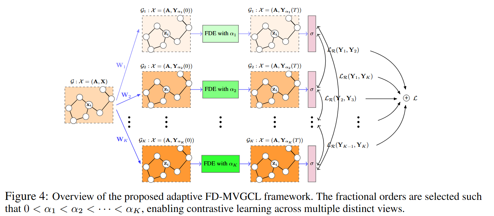

# FD-MVGCL: Adaptive Multi-view Graph Contrastive Learning via Fractional Continuous Dynamics


This repository contains the code for our NeurIPS 2026 accepted paper, *Adaptive Multi-view Graph Contrastive Learning via Fractional Continuous Dynamics*.


## Table of Contents

- [Requirements](#requirements)
- [Framework](#Framework overview)
- [Reproducing Results](#reproducing-results)
- [Citation](#citation)


## Requirements

To install the required dependencies, refer to the `environment.yml` file.


## Framework overview




## Reproducing Results

To reproduce the results in Table 2 and Table 3, run the following commands:


```bash

python GRACE_multi_pde_selected_path.py --dataset chameleon-filtered --add_source --hidden_dim 2048 --time 3 --lr 0.01 --function laplacian --block constant_alpha --runtime 1 --classifier_time 10 --classifier_epochs 500 --cuda 1 --method predictor --classifier_lr 0.01 --classifier_decay 0.001 --batch_norm --step_size 1 --num_encoders 5 --loss cosmean_plus --lambda 0.3 --epoch 2 --alpha_lr_2 0.05 --alpha_lr_3 0.1 --alpha_lr_4 0.1 --alpha_lr_5 0.001 --a1 0.5 --a2 0.03 --a3 0.01 --a4 0.01 --a5 0.45 --dropout 0.2 --seed 1469


```


## Citation

If you find our helpful, consider to cite us:


```bibtex

@INPROCEEDINGS{Zhao:C26b,
    author = {Yanan Zhao and Feng Ji and Jingyang Dai and Jiaze Ma and Keyue Jiang and Kai Zhao and Wee Peng Tay},
    title = {Adaptive Multi-view Graph Contrastive Learning via Fractional Continuous Dynamics},
    booktitle = {Advances in Neural Information Processing Systems},
    volume = {},
    pages = {},
    month = {Dec.},
    year = {2026},
    address = {Sydney, Australia},
}

```

